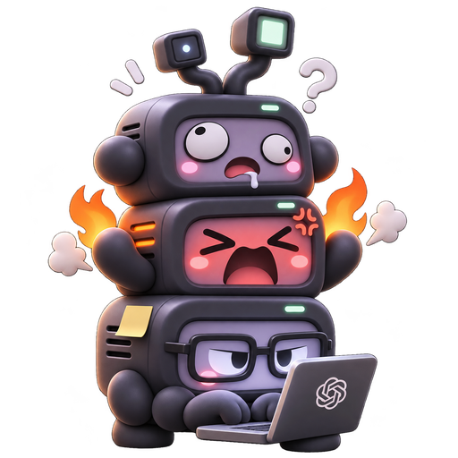
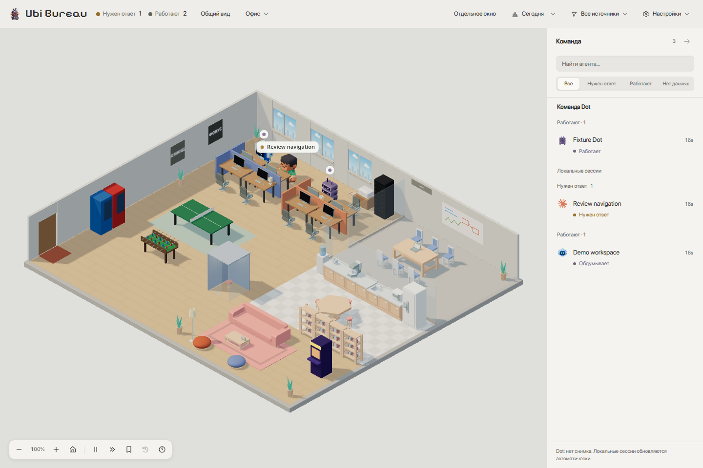

<div align="center">

[**English**](README.md) | [中文](README.zh-CN.md) | [Русский](README.ru.md)

<p align="center">
  
  
</p>

# Ubi Bureau

**A little 3D office for the agents working on your computer.**

[Downloads](https://github.com/romantrnt/ubi-bureau/releases) · [Build](docs/BUILD.md) · [Privacy](docs/PRIVACY.md) · [Dot snapshots](docs/DOT.md) · [Contribute](CONTRIBUTING.md)



<sub>Illustrative test data, not private sessions.</sub>

</div>

Ubi Bureau turns local agent activity into a quiet desktop office: people at their desks, a searchable team roster, and clear signals when someone needs your attention. The Linux window uses GTK4 and WebKitGTK; the office is rendered with Three.js.

It is an independent derivative of [whatsmyagentdoing](https://github.com/Charonyuu/whatsmyagentdoing), with the original MIT attribution preserved. Ubi Bureau adds a focused 3D interface, neutral surfaces, keyboard navigation, camera controls, a native Linux window and explicitly dated Dot snapshots.

## What it does

- **See local work.** Read supported agents' local session stores without changing their conversations. Show activity, recent messages and available model/usage information.
- **Find the right person.** Search and filter the roster, select an agent in the scene, and return from its detail panel without losing your place.
- **Focus the office.** Zoom, restore the overview, save a camera angle, or pause decorative movement while status updates continue.
- **Act deliberately.** Copy resume commands and identifiers. The native Codex button hands a validated conversation link to an installed `codex://` handler; it does not send a prompt or execute the copied command.
- **Keep provenance visible.** Local sessions and Dot observations are separate sources. A Dot snapshot older than 120 seconds becomes **unknown**, not permanently working.

The current desktop interface is Russian. These English, Chinese and Russian READMEs translate the documentation, not the complete application UI.

## Start here

Download `Ubi_Bureau-0.1.0-x86_64.AppImage` and its checksum from [Releases](https://github.com/romantrnt/ubi-bureau/releases).

**This is a host-runtime AppImage, not a self-contained Linux bundle.** It packages Ubi Bureau, its web assets and **Node.js 24.22.3**. System Node is not needed for the AppImage, but Python 3 with PyGObject, GTK4 and **WebKitGTK 6.0** introspection are required. It targets glibc-based Linux x86_64 with working WebGL; GNOME/Wayland is the primary desktop target. The bundled Node runtime requires glibc 2.28+ and compatible libstdc++/libgcc; Alpine/musl is not a supported target. Other distributions and desktops are not automatically certified by the AppImage format.

```sh
chmod +x Ubi_Bureau-0.1.0-x86_64.AppImage
./Ubi_Bureau-0.1.0-x86_64.AppImage --check
./Ubi_Bureau-0.1.0-x86_64.AppImage --demo
# Then show your actual local sessions:
./Ubi_Bureau-0.1.0-x86_64.AppImage
```

If FUSE mounting is unavailable:

```sh
./Ubi_Bureau-0.1.0-x86_64.AppImage --appimage-extract-and-run
```

Close the demo window before launching the normal mode. To change `--demo` or `--private`, close and relaunch the app.

`--demo` uses made-up agents. `--private` hides prompts, replies, titles and transcript contents, but **does not anonymize all metadata**. Inspect the screen before sharing it. `--version` prints the application version. See [build and runtime requirements](docs/BUILD.md) for source usage and troubleshooting.

## Controls

| Key | Action |
| --- | --- |
| `Ctrl K` / `⌘ K` / `/` | Search the team |
| `↑` / `↓`, `Enter` | Move through the roster and open details |
| `F` | Focus the selected agent in the scene |
| `N` | Next agent waiting for you or reporting an error |
| `B` | Hide/show the team panel |
| `+` / `−`, `0` | Zoom, reset to overview |
| `M` | Pause/resume decorative movement |
| `?`, `Esc` | Keyboard help, close/return |

Drag to rotate the scene and scroll to zoom. The bottom toolbar also provides camera save/restore. A saved view stays in local web storage; pausing animation does not pause the data feed.

## Sources and honest limits

The inherited adapters cover Claude Code, Codex, Gemini CLI, Antigravity CLI, GitHub Copilot CLI, OMP, Pi, Kimi Code, DeepSeek Harness, Grok Build, OpenCode and Hermes. Detection depends on readable local stores and compatible client formats. A provider's name here is not a guarantee that every version or desktop variant is supported. OpenCode and Hermes require Node's built-in SQLite support; no data is invented when a store is unavailable.

**Dot is not a live cloud connection.** Ubi Bureau can display an explicitly supplied snapshot of observed workers. There is no supported continuous Dot feed in this release, no automatic cloud polling, and no fabricated model, token or conversation data. Missing input is disconnected; old input becomes unknown. See [the snapshot contract](docs/DOT.md).

The local HTTP server is loopback-only, but is not an authentication boundary against other local programs. Do not expose it through port forwarding, a reverse proxy or a public tunnel. Extra scene packs are optional downloads, verified against the pinned hashes in the catalog. Read [Privacy](docs/PRIVACY.md) before screen sharing or publishing diagnostics.

## Build and contribute

```sh
git clone https://github.com/romantrnt/ubi-bureau.git
cd ubi-bureau
npm ci
npm test
npm run build
```

The checked-in web bundle lets a source checkout run without installing development dependencies. For the native window, use `python3 bin/agent-office.py`; for a browser, use `node bin/cli.js --port 4547`. Use a separate directory and port when keeping an existing upstream installation.

[Build guide](docs/BUILD.md) covers UI/native tests and AppImage packaging. [Contributing](CONTRIBUTING.md) describes synthetic test data and release checks.

## Credits and license

Based on **whatsmyagentdoing v0.8.1** by cheoyu / Charonyuu, at [`c69bf2b`](https://github.com/Charonyuu/whatsmyagentdoing/commit/c69bf2bc98cf96a63d146070e9bbc83b507bf0bf). The original [MIT license](LICENSE) is retained. Office models are Kenney CC0 assets; bundled code, fonts and provider marks retain their own notices and rights. See [Third-party notices](THIRD-PARTY-NOTICES.md). This project is not endorsed by the agent providers.
