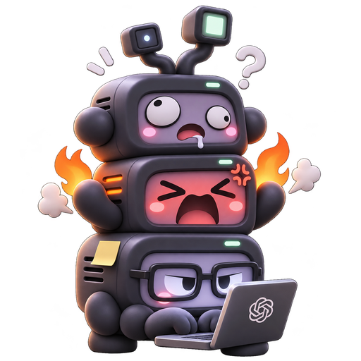
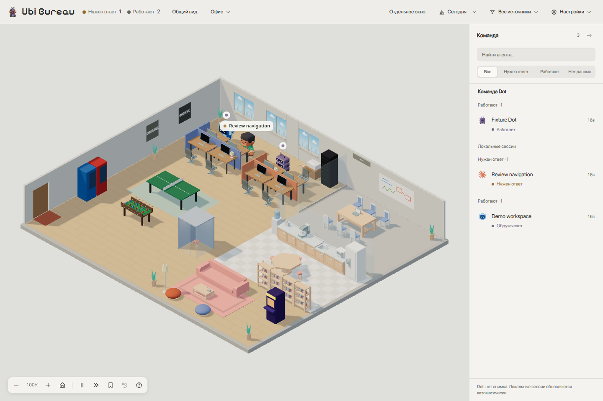

<div align="center">

[English](README.md) | [中文](README.zh-CN.md) | [**Русский**](README.ru.md)

<p align="center">
  
  
</p>

# Ubi Bureau

**Небольшой 3D-офис для агентов, которые работают на вашем компьютере.**

[Скачать](https://github.com/romantrnt/ubi-bureau/releases) · [Сборка](docs/BUILD.md) · [Приватность](docs/PRIVACY.md) · [Снимки Dot](docs/DOT.md) · [Участие](CONTRIBUTING.md)



<sub>Искусственные тестовые данные, не приватные сессии.</sub>

</div>

Ubi Bureau превращает локальную работу агентов в спокойный настольный офис: сотрудники за столами, список команды с поиском и понятные сигналы, когда нужен ваш ответ. Окно Linux построено на GTK4 и WebKitGTK, а офис рисует Three.js.

Это самостоятельная производная от [whatsmyagentdoing](https://github.com/Charonyuu/whatsmyagentdoing) с сохранённой MIT-атрибуцией. Ubi Bureau добавляет сосредоточенный на 3D интерфейс, нейтральное оформление, клавиатурную навигацию, управление камерой, нативное окно Linux и явно датированные снимки Dot.

## Возможности

- **Локальная работа.** Чтение поддерживаемых хранилищ сессий без изменения разговоров. Статусы, последние сообщения, доступные сведения о модели и расходе.
- **Нужный агент под рукой.** Поиск и фильтры команды, выбор персонажа прямо в сцене, возврат из карточки без потери места в списке.
- **Удобная камера.** Масштаб, общий вид, сохранение ракурса и пауза декоративного движения. Данные продолжают обновляться.
- **Действия под контролем.** Копирование команды продолжения и идентификаторов. Кнопка Codex в нативном окне передаёт проверенную ссылку установленному обработчику `codex://`, но не отправляет запрос и не запускает скопированную команду.
- **Честные источники.** Локальные сессии и наблюдения Dot разделены. Снимок Dot старше 120 секунд получает статус **«Нет свежих данных»**, а не остаётся вечно работающим.

Текущий настольный интерфейс русскоязычный. README на английском, китайском и русском переводят документацию, а не весь интерфейс приложения.

## Быстрый старт

Скачайте `Ubi_Bureau-0.1.0-x86_64.AppImage` и контрольную сумму из [Releases](https://github.com/romantrnt/ubi-bureau/releases).

**Это AppImage с системными зависимостями, а не полностью автономная сборка.** В него входят Ubi Bureau, веб-ресурсы и **Node.js 24.22.3**. Системный Node для AppImage не нужен, но на компьютере требуются Python 3 с PyGObject, GTK4 и introspection для **WebKitGTK 6.0**. Целевая платформа: Linux x86_64 на glibc с работающим WebGL, прежде всего GNOME/Wayland. Встроенный Node требует glibc 2.28+ и совместимые libstdc++/libgcc; Alpine/musl не заявлены как поддерживаемые. Сам формат AppImage не гарантирует совместимость с каждым дистрибутивом и окружением.

```sh
chmod +x Ubi_Bureau-0.1.0-x86_64.AppImage
./Ubi_Bureau-0.1.0-x86_64.AppImage --check
./Ubi_Bureau-0.1.0-x86_64.AppImage --demo
# Затем открыть настоящие локальные сессии:
./Ubi_Bureau-0.1.0-x86_64.AppImage
```

Если FUSE недоступен:

```sh
./Ubi_Bureau-0.1.0-x86_64.AppImage --appimage-extract-and-run
```

Перед обычным запуском закройте демонстрационное окно. Чтобы изменить режим `--demo` или `--private`, закройте и снова запустите приложение.

`--demo` показывает вымышленных агентов. `--private` скрывает запросы, ответы, заголовки и содержимое переписки, но **не обезличивает все метаданные**. Перед демонстрацией экрана проверьте, что на нём видно. `--version` печатает версию. Подробности в [руководстве по сборке и запуску](docs/BUILD.md).

## Управление

| Клавиши | Действие |
| --- | --- |
| `Ctrl K` / `⌘ K` / `/` | Поиск по команде |
| `↑` / `↓`, `Enter` | Перемещение по списку и открытие карточки |
| `F` | Показать выбранного агента в сцене |
| `N` | Следующий агент, которому нужен ответ или у которого ошибка |
| `B` | Скрыть/показать панель команды |
| `+` / `−`, `0` | Масштаб, общий вид |
| `M` | Пауза/возобновление декоративного движения |
| `?`, `Esc` | Справка по клавишам, закрытие/возврат |

Перетаскивание вращает сцену, колесо меняет масштаб. Нижняя панель позволяет сохранить и вернуть ракурс. Он хранится локально; пауза движения не останавливает получение статусов.

## Источники и ограничения

Унаследованные адаптеры работают с Claude Code, Codex, Gemini CLI, Antigravity CLI, GitHub Copilot CLI, OMP, Pi, Kimi Code, DeepSeek Harness, Grok Build, OpenCode и Hermes. Обнаружение зависит от доступности локального хранилища и совместимости его формата. Наличие названия в списке не означает поддержку всех версий и настольных вариантов. OpenCode и Hermes требуют встроенной поддержки SQLite в Node. Если источник недоступен, приложение не выдумывает данные.

**Dot не подключён к постоянному облачному live-потоку.** Приложение показывает явно переданный снимок наблюдавшихся работников. В этой версии нет поддерживаемого непрерывного канала Dot, автоматического опроса облака или выдуманных моделей, токенов и переписки. Без снимка источник отключён; устаревшие данные становятся неизвестными. См. [формат снимка](docs/DOT.md).

HTTP-сервер слушает только loopback, но это не защита от других локальных программ. Не публикуйте его через прокси, туннель или проброс порта. Дополнительные сцены загружаются по выбору и проверяются по закреплённым хешам каталога. Перед демонстрацией экрана и публикацией диагностики прочитайте [о приватности](docs/PRIVACY.md).

## Сборка и участие

```sh
git clone https://github.com/romantrnt/ubi-bureau.git
cd ubi-bureau
npm ci
npm test
npm run build
```

Готовый веб-бандл хранится в репозитории, поэтому для запуска из исходников не нужно устанавливать зависимости разработки. Нативное окно: `python3 bin/agent-office.py`. Браузер: `node bin/cli.js --port 4547`. Если сохраняете upstream-установку, используйте отдельную папку и порт.

[Руководство по сборке](docs/BUILD.md) описывает UI/native-тесты и AppImage. [Правила участия](CONTRIBUTING.md) объясняют работу с искусственными данными и проверки релиза.

## Авторы и лицензия

Основано на **whatsmyagentdoing v0.8.1** от cheoyu / Charonyuu, коммит [`c69bf2b`](https://github.com/Charonyuu/whatsmyagentdoing/commit/c69bf2bc98cf96a63d146070e9bbc83b507bf0bf). Исходная [MIT-лицензия](LICENSE) сохранена. Модели офиса: Kenney, CC0. Код зависимостей, шрифты и знаки провайдеров сохраняют свои уведомления и права. См. [сторонние компоненты](THIRD-PARTY-NOTICES.md). Проект не одобрен и не спонсируется провайдерами агентов.
