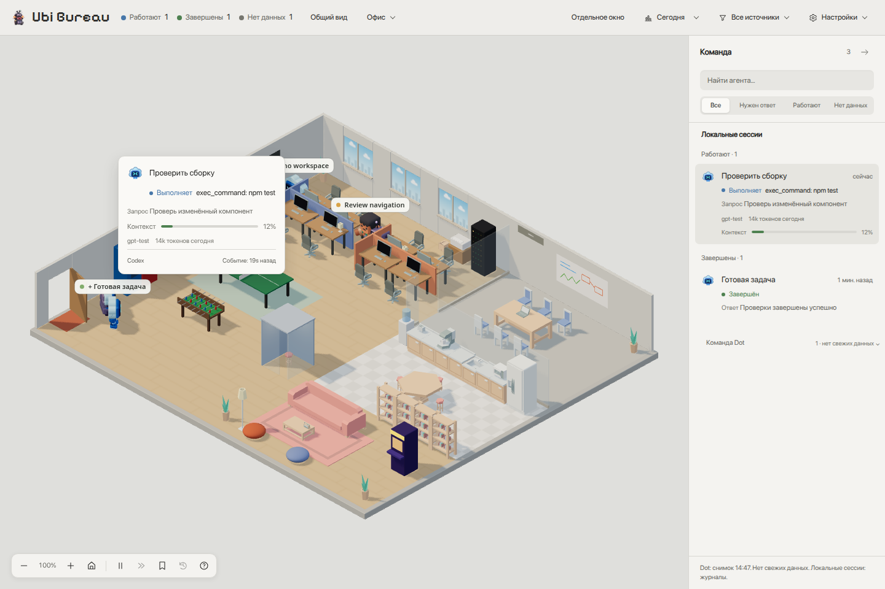

<div align="center">

[English](README.md) | [**中文**](README.zh-CN.md) | [Русский](README.ru.md)

<p align="center">
  
  
</p>

# Ubi Bureau

**为你电脑上正在工作的智能体打造的小小 3D 办公室。**

[下载](https://github.com/romantrnt/ubi-bureau/releases) · [构建](docs/BUILD.md) · [隐私](docs/PRIVACY.md) · [Dot 快照](docs/DOT.md) · [参与贡献](CONTRIBUTING.md)



<sub>画面使用人工测试数据，不包含私人会话。</sub>

</div>

Ubi Bureau 将本机智能体的活动呈现在一个安静的桌面办公室中：角色坐在办公桌前，团队列表可以搜索，需要你回复时会给出清晰提示。Linux 窗口采用 GTK4 和 WebKitGTK，办公室由 Three.js 渲染。

本项目独立衍生自 [whatsmyagentdoing](https://github.com/Charonyuu/whatsmyagentdoing)，保留原始 MIT 署名。Ubi Bureau 增加了专注于 3D 的界面、中性色调、键盘导航、相机控制、原生 Linux 窗口，以及明确标注观察时间的 Dot 快照。

## 功能

- **查看本机工作。** 读取受支持智能体的本地会话存储，不修改对话。显示活动、最近消息及已有的模型和用量信息。
- **快速找到智能体。** 搜索与筛选团队列表，在场景中选择角色，并在关闭详情后回到原位置。
- **调整办公室视角。** 缩放、返回全景、保存视角，或暂停装饰性动画。暂停动画不会停止状态更新。
- **明确执行操作。** 复制继续会话的命令或标识符。原生窗口中的 Codex 按钮将经过验证的会话链接交给已安装的 `codex://` 处理程序，不会发送提示词或执行复制的命令。
- **区分数据来源。** 本机会话与 Dot 观察结果分别显示。超过 120 秒的 Dot 快照变为**未知**，不会一直显示为正在工作。

当前桌面界面为俄语。这三份 README 是文档翻译，不代表完整的界面本地化。

## 更新

0.2.0 支持带签名的 AppImage 更新：应用打开时可通知或自动下载，但安装始终需要明确确认。保留旧版本备份，不会静默安装或自动重启。默认每 24 小时检查，可关闭。0.1.0 需要先手动替换一次。[更新机制、安全与限制](docs/UPDATES.md)。

## 开始使用

从 [Releases](https://github.com/romantrnt/ubi-bureau/releases) 下载 `Ubi_Bureau-0.2.0-x86_64.AppImage` 及其校验和。

**这是依赖主机运行环境的 AppImage，并非完全自包含的软件包。** 它包含 Ubi Bureau、网页资源和 **Node.js 24.22.3**。运行 AppImage 不需要系统 Node，但仍需 Python 3、PyGObject、GTK4 和 **WebKitGTK 6.0** introspection。目标平台为基于 glibc、支持 WebGL 的 Linux x86_64，主要面向 GNOME/Wayland。内置 Node 要求 glibc 2.28+ 及兼容的 libstdc++/libgcc；不声明支持 Alpine/musl。AppImage 格式本身不保证兼容每一种发行版和桌面环境。

```sh
chmod +x Ubi_Bureau-0.2.0-x86_64.AppImage
./Ubi_Bureau-0.2.0-x86_64.AppImage --check
./Ubi_Bureau-0.2.0-x86_64.AppImage --demo
# 然后显示真实的本机会话：
./Ubi_Bureau-0.2.0-x86_64.AppImage
```

如果无法使用 FUSE 挂载：

```sh
./Ubi_Bureau-0.2.0-x86_64.AppImage --appimage-extract-and-run
```

切换到普通模式前，请先关闭演示窗口。更改 `--demo` 或 `--private` 模式时，需要关闭并重新启动应用。

`--demo` 使用虚构智能体。`--private` 隐藏提示词、回复、标题和对话内容，但**不会匿名化所有元数据**。共享屏幕前仍应检查画面。`--version` 输出版本号。依赖、源码运行和故障排查见[构建指南](docs/BUILD.md)。

## 操作

| 按键 | 功能 |
| --- | --- |
| `Ctrl K` / `⌘ K` / `/` | 搜索团队 |
| `↑` / `↓`、`Enter` | 在列表中移动并打开详情 |
| `F` | 在场景中聚焦所选智能体 |
| `N` | 跳到下一个等待回复或报告错误的智能体 |
| `B` | 隐藏/显示团队面板 |
| `+` / `−`、`0` | 缩放、恢复全景 |
| `M` | 暂停/恢复装饰性动画 |
| `?`、`Esc` | 键盘帮助、关闭/返回 |

拖动可旋转场景，滚轮可缩放。底部工具栏还可保存和恢复视角。视角保存在本地网页存储中；暂停动画不影响数据更新。

## 数据来源与限制

继承的适配器涵盖 Claude Code、Codex、Gemini CLI、Antigravity CLI、GitHub Copilot CLI、OMP、Pi、Kimi Code、DeepSeek Harness、Grok Build、OpenCode 和 Hermes。能否发现会话取决于本地存储是否可读、客户端格式是否兼容。列出某个名称并不保证支持它的所有版本和桌面变体。OpenCode 和 Hermes 需要 Node 内置的 SQLite 支持。来源不可用时，应用不会编造数据。

**Dot 不是持续的云端实时连接。** 应用只能显示明确提供的工作状态快照。本版本没有受支持的连续 Dot 数据源，也不会自动轮询云端或编造模型、用量和对话内容。没有输入时显示未连接；过期后显示未知。详见[快照约定](docs/DOT.md)。

本地 HTTP 服务只监听 loopback，但这不能阻止其他本机程序访问。不要通过反向代理、端口转发或公开隧道暴露服务。额外场景按需下载，并核对目录中固定的哈希值。共享屏幕或发布诊断信息前，请阅读[隐私说明](docs/PRIVACY.md)。

## 构建与贡献

```sh
git clone https://github.com/romantrnt/ubi-bureau.git
cd ubi-bureau
npm ci
npm test
npm run build
```

仓库包含已构建的网页资源，因此源码运行不需要安装开发依赖。原生窗口：`python3 bin/agent-office.py`；浏览器：`node bin/cli.js --port 4547`。保留原版安装时，请使用独立目录和端口。

[构建指南](docs/BUILD.md)包含 UI、原生测试及 AppImage 打包说明。[贡献指南](CONTRIBUTING.md)介绍人工测试数据和发布检查。

## 致谢与许可

基于 cheoyu / Charonyuu 的 **whatsmyagentdoing v0.8.1**，提交 [`c69bf2b`](https://github.com/Charonyuu/whatsmyagentdoing/commit/c69bf2bc98cf96a63d146070e9bbc83b507bf0bf)。保留原始 [MIT 许可证](LICENSE)。办公室模型来自 Kenney，采用 CC0。依赖代码、字体与提供商标志仍受各自许可和权利约束。详见[第三方声明](THIRD-PARTY-NOTICES.md)。本项目未获相关智能体提供商背书。
